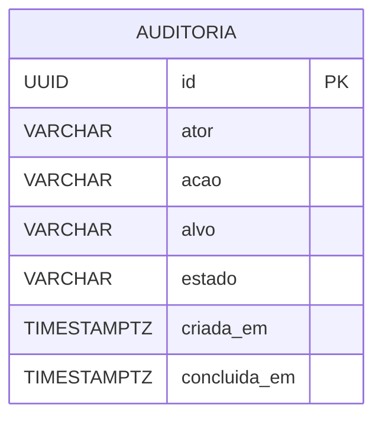
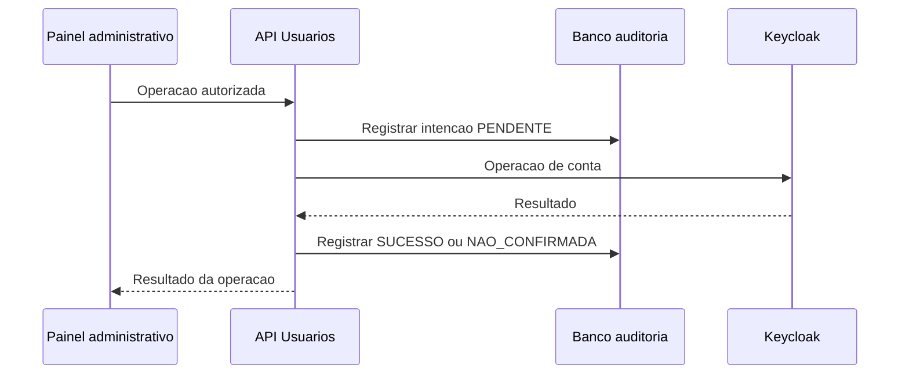

# Contexto técnico — usuarios-auditoria

Trechos temáticos do README da main. Confira o código e o README vigente se o contrato tiver mudado.

## Auditoria

Antes de uma alteração externa, a API grava uma intenção PENDENTE com operador, ação, alvo e data. Após a resposta do Keycloak, grava SUCESSO ou NAO_CONFIRMADA. NAO_CONFIRMADA pode representar falha ou execução parcial; um timeout após uma alteração não permite concluir que nada foi alterado. PENDENTE pode indicar uma interrupção ou falha ao registrar o resultado. Em ambos os casos, confira o Keycloak antes de repetir a ação.

O PostgreSQL deve estar disponível para registrar a intenção antes da chamada externa. Não existe transação distribuída entre banco e Keycloak. Dados de formulário, senhas, access tokens e client secrets não são registrados. A migration Flyway `V1__create_auditoria.sql` cria a tabela e seu índice. A lista de auditoria é restrita a administradores.

### Modelo de dados

| Coluna | Tipo e finalidade |
| --- | --- |
| id | UUID, PK |
| ator | VARCHAR(64), identificador obrigatório do operador autenticado |
| acao | VARCHAR(40), ação obrigatória |
| alvo | VARCHAR(64), ID opcional da conta atingida |
| estado | VARCHAR(16), obrigatório; CHECK permite PENDENTE, SUCESSO e NAO_CONFIRMADA |
| criada_em | TIMESTAMPTZ, instante obrigatório da intenção |
| concluida_em | TIMESTAMPTZ, instante opcional de conclusão |

O índice ix_auditoria_criada ordena por data e ID. Não há FK para as contas mantidas pelo Keycloak. A migration [V1__create_auditoria.sql](../../../../src/main/resources/db/migration/V1__create_auditoria.sql) cria essa tabela. Não se guarda senha, token ou cadastro duplicado.

### SQL Injection e consistência

AuditoriaRepository usa JdbcTemplate com placeholders `?` nas instruções INSERT/UPDATE e paginação da consulta SELECT. Os valores de ator, ação, alvo, estado e limites são passados como parâmetros, não concatenados a instruções SQL. A validação de JWT exige audiência bibliogest-usuarios e ADMINISTRADOR.

A auditoria não forma transação distribuída com o Keycloak; falhas incertas requerem conferência antes de repetir. Permissões administrativas são limitadas às operações previstas; contas protegidas e o próprio operador não podem ser alterados pelo painel.
