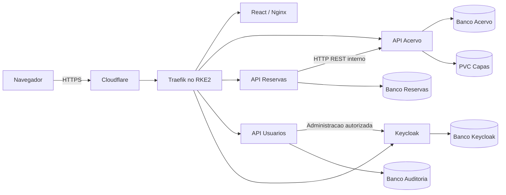

# Contexto técnico — usuarios-deploy-docker

Trechos temáticos do README da main. Confira o código e o README vigente se o contrato tiver mudado.

## Arquitetura do BiblioGest

O BiblioGest é uma aplicação de gestão de bibliotecas baseada em microsserviços REST. Cada serviço tem uma responsabilidade e persistência próprias. O Keycloak centraliza identidade e autenticação; a integração entre serviços ocorre por HTTP, sem compartilhar entidades JPA ou consultar diretamente o banco de outro microsserviço.



Os bancos lógicos são independentes, hospedados na instância PostgreSQL do projeto. As capas ficam em volume persistente; o banco de Acervo guarda a referência. O ambiente usa Docker para construção de imagens, containerd e Kubernetes RKE2 para execução, Rancher para gerenciamento, Traefik para roteamento, Nginx para frontend e Cloudflare na borda. GitHub Actions executa validações e build; o deploy é uma operação separada. O pgAdmin é ferramenta de administração do banco, não parte do acesso do leitor.

| Componente | Responsabilidade | Repositório |
| --- | --- | --- |
| Frontend | Catálogo, reservas, balcão e administração | [bibliogest-frontend](https://github.com/ksferreira35/bibliogest-frontend) |
| Acervo | Obras, autores, categorias, exemplares e capas | [bibliogest-acervo](https://github.com/ksferreira35/bibliogest-acervo) |
| Reservas | Disponibilidade e circulação dos exemplares | [bibliogest-reservas](https://github.com/ksferreira35/bibliogest-reservas) |
| Usuários | Administração de contas e auditoria | [bibliogest-usuarios](https://github.com/ksferreira35/bibliogest-usuarios) |

## Testes e CI

```bash
./mvnw --batch-mode --no-transfer-progress clean verify
```

A suíte usa PostgreSQL real via Testcontainers (Docker necessário), MockMvc e um provedor HTTP simulado. Cobre autorização por role, claims inválidas, criação, status, proteção de contas, mapeamento da função permitida, auditoria e respostas inválidas ou indisponibilidade do provedor. Os testes não dependem de senhas ou contas reais do sistema.

Checkstyle verifica o código; JaCoCo exige ao menos **80% de linhas e branches**, sem excluir services ou controllers. O CI usa `needs`: lint → testes/cobertura → empacotamento. Relatórios HTML e JUnit ficam em `target/site/jacoco/` e `target/surefire-reports/`, e no artefato `coverage-and-tests` do GitHub Actions. O resumo do job contém os percentuais.
