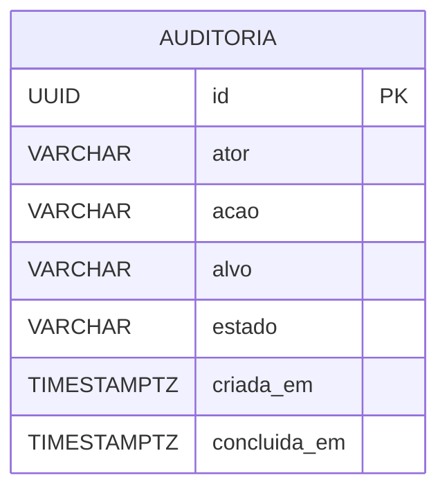
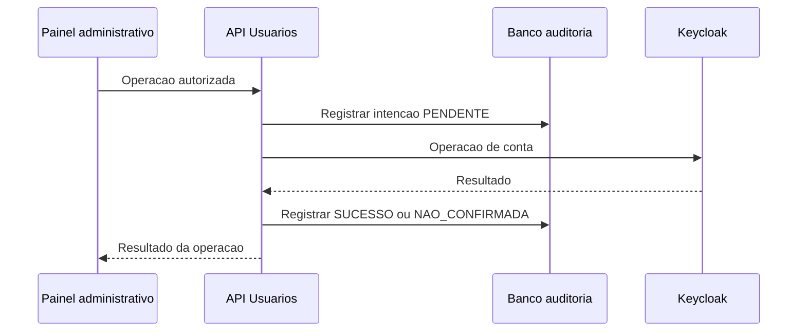

# Contexto técnico — usuarios-spring-boot

Trechos temáticos do README da main. Confira o código e o README vigente se o contrato tiver mudado.

## Operações

Prefixo público: `/usuarios/api/v1`. Todos os endpoints exigem um JWT válido, audiência `bibliogest-usuarios` e a role **ADMINISTRADOR**. LEITOR e BIBLIOTECARIO não recebem acesso administrativo.

| Método | Caminho                                | Operação                                                             |
| ------ | -------------------------------------- | -------------------------------------------------------------------- |
| GET    | `/usuarios?busca=&pagina=0&tamanho=20` | Buscar contas humanas; página começa em zero, tamanho máximo 20      |
| GET    | `/usuarios/{id}`                       | Consultar perfil, status, função e proteção da conta                 |
| POST   | `/usuarios`                            | Criar leitor com `nome`, `sobrenome`, `email`, `senhaTemporaria`     |
| PUT    | `/usuarios/{id}/bibliotecario`         | Corpo `{"valor":true}` promove; `false` remove somente BIBLIOTECARIO |
| PUT    | `/usuarios/{id}/ativo`                 | Ativar ou desativar com `{"valor":true/false}`                       |
| POST   | `/usuarios/{id}/encerrar-sessoes`      | Encerrar sessões no Keycloak                                         |
| GET    | `/auditoria?pagina=0&tamanho=20`       | Consultar ações administrativas                                      |

A senha inicial tem entre 12 e 128 caracteres e deve ser trocada no primeiro acesso. A criação depende da política de senha do realm e da role padrão LEITOR já configurada no Keycloak. A senha não aparece na resposta nem na auditoria. O painel não oferece redefinição de senha, exclusão de usuários, criação de administradores, impersonação ou edição de clientes/realms.

A própria conta do operador, contas técnicas, usuários com ADMINISTRADOR e usuários com permissões administrativas em `realm-management` são protegidos contra alterações pelo painel. Identidades e roles do operador vêm do JWT validado, não do corpo da requisição. Criar novos administradores continua sendo uma operação feita diretamente no Keycloak.

## Organização interna e persistência

Java 21, Spring Boot, Spring Security, Spring JDBC (JdbcTemplate), PostgreSQL e Flyway. UsuarioController expõe operações administrativas, UsuarioService aplica regras de proteção e auditoria, KeycloakClient integra com o provedor e AuditoriaRepository registra os eventos. Keycloak é a fonte das contas, não o banco de auditoria.

### Modelo de dados

| Coluna | Tipo e finalidade |
| --- | --- |
| id | UUID, PK |
| ator | VARCHAR(64), identificador obrigatório do operador autenticado |
| acao | VARCHAR(40), ação obrigatória |
| alvo | VARCHAR(64), ID opcional da conta atingida |
| estado | VARCHAR(16), obrigatório; CHECK permite PENDENTE, SUCESSO e NAO_CONFIRMADA |
| criada_em | TIMESTAMPTZ, instante obrigatório da intenção |
| concluida_em | TIMESTAMPTZ, instante opcional de conclusão |

O índice ix_auditoria_criada ordena por data e ID. Não há FK para as contas mantidas pelo Keycloak. A migration [V1__create_auditoria.sql](../../../../src/main/resources/db/migration/V1__create_auditoria.sql) cria essa tabela. Não se guarda senha, token ou cadastro duplicado.

### SQL Injection e consistência

AuditoriaRepository usa JdbcTemplate com placeholders `?` nas instruções INSERT/UPDATE e paginação da consulta SELECT. Os valores de ator, ação, alvo, estado e limites são passados como parâmetros, não concatenados a instruções SQL. A validação de JWT exige audiência bibliogest-usuarios e ADMINISTRADOR.

A auditoria não forma transação distribuída com o Keycloak; falhas incertas requerem conferência antes de repetir. Permissões administrativas são limitadas às operações previstas; contas protegidas e o próprio operador não podem ser alterados pelo painel.
