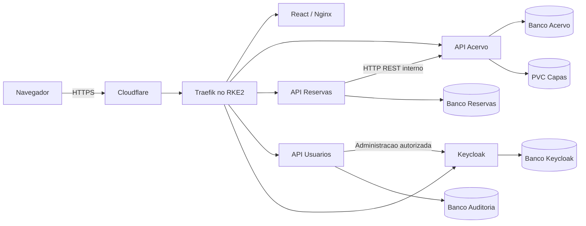
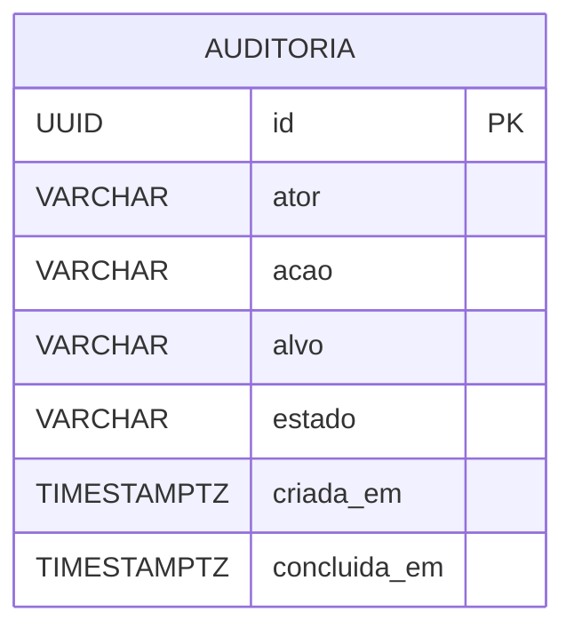
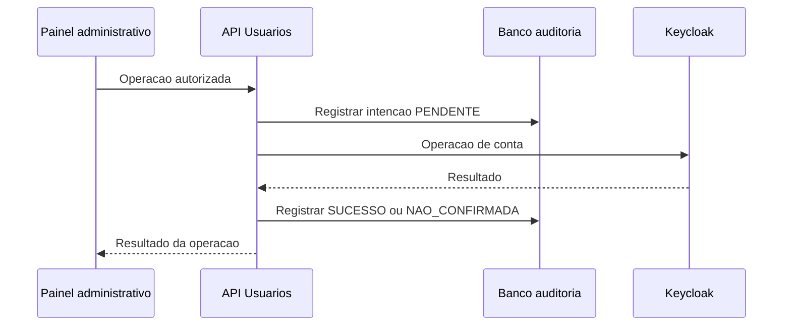

# BiblioGest — Usuários

API de administração de contas em Java 21 e Spring Boot 4.1.2. Integra o realm `bibliogest` do Keycloak; o PostgreSQL guarda apenas a auditoria, sem duplicar senhas ou o cadastro de usuários.

## Operações

Prefixo público: `/usuarios/api/v1`. Todos os endpoints exigem um JWT válido, audiência `bibliogest-usuarios` e a role **ADMINISTRADOR**. LEITOR e BIBLIOTECARIO não recebem acesso administrativo.

| Método | Caminho                                | Operação                                                             |
| ------ | -------------------------------------- | -------------------------------------------------------------------- |
| GET    | `/usuarios?busca=&pagina=0&tamanho=20` | Buscar contas humanas; página começa em zero, tamanho máximo 20      |
| GET    | `/usuarios/{id}`                       | Consultar perfil, status, função e proteção da conta                 |
| POST   | `/usuarios`                            | Criar leitor com `nome`, `sobrenome`, `email`, `senhaTemporaria`     |
| PUT    | `/usuarios/{id}/bibliotecario`         | Corpo `{"valor":true}` promove; `false` remove somente BIBLIOTECARIO |
| PUT    | `/usuarios/{id}/ativo`                 | Ativar ou desativar com `{"valor":true/false}`                       |
| POST   | `/usuarios/{id}/encerrar-sessoes`      | Encerrar sessões no Keycloak                                         |
| GET    | `/auditoria?pagina=0&tamanho=20`       | Consultar ações administrativas                                      |

A senha inicial tem entre 12 e 128 caracteres e deve ser trocada no primeiro acesso. A criação depende da política de senha do realm e da role padrão LEITOR já configurada no Keycloak. A senha não aparece na resposta nem na auditoria. O painel não oferece redefinição de senha, exclusão de usuários, criação de administradores, impersonação ou edição de clientes/realms.

A própria conta do operador, contas técnicas, usuários com ADMINISTRADOR e usuários com permissões administrativas em `realm-management` são protegidos contra alterações pelo painel. Identidades e roles do operador vêm do JWT validado, não do corpo da requisição. Criar novos administradores continua sendo uma operação feita diretamente no Keycloak.

## Keycloak e credenciais

O cliente confidencial `bibliogest-usuarios-admin` usa client credentials e permissões granulares V2 do Keycloak. Ele recebe a role de consulta `query-users`, permissões de visualização/gerenciamento de usuários e permissão de mapear **somente BIBLIOTECARIO**. Não recebe `manage-users`, `realm-admin`, `manage-clients` nem `impersonation`, que ampliariam ou contornariam as regras granulares.

O cliente público `bibliogest-react` pode incluir ADMINISTRADOR no token apenas quando a conta possui essa role; isso não concede a role a outros usuários. Um audience mapper acrescenta `bibliogest-usuarios` aos access tokens. O client secret administrativo existe apenas no backend, por referência ao Secret Kubernetes `usuarios-keycloak`.

Os endpoints externos são fixos; IDs de usuário são UUIDs e não determinam host, realm ou operação arbitrária. O cliente HTTP tem timeouts e não segue redirecionamentos. Respostas devolvem somente campos permitidos; erros do provedor não expõem seu conteúdo interno.

Ao desativar uma conta ou alterar BIBLIOTECARIO, suas sessões são encerradas. JWTs já emitidos e validados offline pelas APIs podem continuar válidos até expirar (atualmente até cinco minutos); encerrar sessões impede a continuidade via refresh token, mas não promete revogação instantânea desses JWTs.

## Auditoria

Antes de uma alteração externa, a API grava uma intenção PENDENTE com operador, ação, alvo e data. Após a resposta do Keycloak, grava SUCESSO ou NAO_CONFIRMADA. NAO_CONFIRMADA pode representar falha ou execução parcial; um timeout após uma alteração não permite concluir que nada foi alterado. PENDENTE pode indicar uma interrupção ou falha ao registrar o resultado. Em ambos os casos, confira o Keycloak antes de repetir a ação.

O PostgreSQL deve estar disponível para registrar a intenção antes da chamada externa. Não existe transação distribuída entre banco e Keycloak. Dados de formulário, senhas, access tokens e client secrets não são registrados. A migration Flyway `V1__create_auditoria.sql` cria a tabela e seu índice. A lista de auditoria é restrita a administradores.

## Desenvolvimento

Copie `.env.example` para `.env` e preencha credenciais de um ambiente de desenvolvimento isolado. Não use o cliente administrativo de produção para testes locais. A configuração de execução do IntelliJ pode carregar o arquivo. Pelo terminal:

```bash
set -a
source .env
set +a
./mvnw spring-boot:run
```

Use PostgreSQL próprio para desenvolvimento. O Swagger local está em `http://localhost:8082/usuarios/swagger-ui/index.html`; use Authorize com um access token de administrador. Swagger fica desligado em produção. A saúde de prontidão está em `/usuarios/actuator/health/readiness`.

## Testes e CI

```bash
./mvnw --batch-mode --no-transfer-progress clean verify
```

A suíte usa PostgreSQL real via Testcontainers (Docker necessário), MockMvc e um provedor HTTP simulado. Cobre autorização por role, claims inválidas, criação, status, proteção de contas, mapeamento da função permitida, auditoria e respostas inválidas ou indisponibilidade do provedor. Os testes não dependem de senhas ou contas reais do sistema.

Checkstyle verifica o código; JaCoCo exige ao menos **80% de linhas e branches**, sem excluir services ou controllers. O CI usa `needs`: lint → testes/cobertura → empacotamento. Relatórios HTML e JUnit ficam em `target/site/jacoco/` e `target/surefire-reports/`, e no artefato `coverage-and-tests` do GitHub Actions. O resumo do job contém os percentuais.

## Produção

O Dockerfile usa build Maven e runtime Java 21 sem root. O pod usa filesystem somente leitura, `/tmp` efêmero e não recebe token da ServiceAccount Kubernetes. Credenciais do banco vêm de `usuarios-db`; o segredo do cliente vem de `usuarios-keycloak`. IDs públicos de roles/clientes ficam em `usuarios-config`. O Ingress encaminha apenas `/usuarios/api` para o Service interno. NetworkPolicies autorizam entrada pelo Traefik e acesso do serviço ao PostgreSQL e Keycloak.

O banco `bibliogest_usuarios` possui um usuário próprio com o mesmo nome. Além da NetworkPolicy, o `postgres-hba` precisa permitir esse par banco/usuário com `scram-sha-256` na rede dos pods (`10.42.0.0/16` neste cluster), antes da regra final de rejeição. Após atualizar o ConfigMap, aguarde a projeção no volume e execute `SELECT pg_reload_conf()` por uma conexão administrativa local; não é necessário reiniciar o PostgreSQL. A regra está no manifesto `deploy/k8s/10-postgres.yaml` do Acervo, que mantém os recursos compartilhados.

O frontend utiliza `/usuarios/api` na mesma origem, portanto não há liberação genérica de CORS. A CSP continua sendo fornecida pelo Nginx do frontend. `.env`, dumps, chaves privadas, `target` e README não entram na imagem. Faça backup do Keycloak antes de configurar clientes/policies e preserve o banco de auditoria entre atualizações.

## Arquitetura do BiblioGest

O BiblioGest é uma aplicação de gestão de bibliotecas baseada em microsserviços REST. Cada serviço tem uma responsabilidade e persistência próprias. O Keycloak centraliza identidade e autenticação; a integração entre serviços ocorre por HTTP, sem compartilhar entidades JPA ou consultar diretamente o banco de outro microsserviço.



Os bancos lógicos são independentes, hospedados na instância PostgreSQL do projeto. As capas ficam em volume persistente; o banco de Acervo guarda a referência. O ambiente usa Docker para construção de imagens, containerd e Kubernetes RKE2 para execução, Rancher para gerenciamento, Traefik para roteamento, Nginx para frontend e Cloudflare na borda. GitHub Actions executa validações e build; o deploy é uma operação separada. O pgAdmin é ferramenta de administração do banco, não parte do acesso do leitor.

| Componente | Responsabilidade | Repositório |
| --- | --- | --- |
| Frontend | Catálogo, reservas, balcão e administração | [bibliogest-frontend](https://github.com/ksferreira35/bibliogest-frontend) |
| Acervo | Obras, autores, categorias, exemplares e capas | [bibliogest-acervo](https://github.com/ksferreira35/bibliogest-acervo) |
| Reservas | Disponibilidade e circulação dos exemplares | [bibliogest-reservas](https://github.com/ksferreira35/bibliogest-reservas) |
| Usuários | Administração de contas e auditoria | [bibliogest-usuarios](https://github.com/ksferreira35/bibliogest-usuarios) |

## Organização interna e persistência

Java 21, Spring Boot, Spring Security, Spring JDBC (JdbcTemplate), PostgreSQL e Flyway. UsuarioController expõe operações administrativas, UsuarioService aplica regras de proteção e auditoria, KeycloakClient integra com o provedor e AuditoriaRepository registra os eventos. Keycloak é a fonte das contas, não o banco de auditoria.

### Modelo de dados



| Coluna | Tipo e finalidade |
| --- | --- |
| id | UUID, PK |
| ator | VARCHAR(64), identificador obrigatório do operador autenticado |
| acao | VARCHAR(40), ação obrigatória |
| alvo | VARCHAR(64), ID opcional da conta atingida |
| estado | VARCHAR(16), obrigatório; CHECK permite PENDENTE, SUCESSO e NAO_CONFIRMADA |
| criada_em | TIMESTAMPTZ, instante obrigatório da intenção |
| concluida_em | TIMESTAMPTZ, instante opcional de conclusão |

O índice ix_auditoria_criada ordena por data e ID. Não há FK para as contas mantidas pelo Keycloak. A migration [V1__create_auditoria.sql](src/main/resources/db/migration/V1__create_auditoria.sql) cria essa tabela. Não se guarda senha, token ou cadastro duplicado.

### SQL Injection e consistência

AuditoriaRepository usa JdbcTemplate com placeholders `?` nas instruções INSERT/UPDATE e paginação da consulta SELECT. Os valores de ator, ação, alvo, estado e limites são passados como parâmetros, não concatenados a instruções SQL. A validação de JWT exige audiência bibliogest-usuarios e ADMINISTRADOR.



A auditoria não forma transação distribuída com o Keycloak; falhas incertas requerem conferência antes de repetir. Permissões administrativas são limitadas às operações previstas; contas protegidas e o próprio operador não podem ser alterados pelo painel.

## Matriz de permissões

As roles são atribuídas no Keycloak e verificadas nas APIs. Uma conta pode acumular roles; ADMINISTRADOR por si só não equivale a LEITOR ou BIBLIOTECARIO.

| Operação | LEITOR | BIBLIOTECARIO | ADMINISTRADOR |
| --- | --- | --- | --- |
| Consultar catálogo e disponibilidade | Sim | Sim | Se também leitor/bibliotecário |
| Criar reserva pessoal | Sim | Se também leitor | Se também leitor |
| Consultar reservas próprias | Sim | Sim | Se também leitor/bibliotecário |
| Cancelar reserva aguardando retirada | Própria | Sim | Conforme outras roles |
| Consultar balcão, registrar retirada/devolução | Não | Sim | Se também bibliotecário |
| Cadastrar e editar acervo | Não | Sim | Se também bibliotecário |
| Administrar contas e consultar auditoria | Não | Não | Sim |

A ausência de autenticação válida leva a 401; uma role insuficiente leva a 403. Consultas a reservas de terceiros sem autorização devolvem 404 conforme o contrato. IDs técnicos identificam recursos; não substituem autorização.

## Segurança em camadas

| Controle | Implementação e finalidade |
| --- | --- |
| Autenticação | Keycloak, OAuth 2.0/OIDC, PKCE S256 no frontend; tokens JWT Bearer nas APIs. |
| Autorização | Spring Security verifica assinatura, emissor, audiência e expiração; roles e propriedade dos recursos são avaliadas no backend. |
| SQL Injection | Dados de entrada são tratados como valores tipados em consultas parametrizadas nos repositories, não como trechos de SQL. Validação de entrada complementa essa proteção. |
| XSS | React renderiza conteúdo textual com escape; CSP no Nginx limita recursos autorizados no navegador. |
| CSRF | As APIs são stateless e autorizam via Bearer explícito, não por cookie de sessão enviado automaticamente. CSRF do Spring está desativado para esse modelo. Isso não elimina os controles do Keycloak no login. |
| CORS | APIs e frontend usam a mesma origem pública; os caminhos são roteados pelo Ingress. Vite usa proxy no desenvolvimento. Web Origins do Keycloak é configurado no cliente, sem liberação genérica. CORS não substitui autenticação. |
| Clickjacking | Nginx envia X-Frame-Options DENY e CSP frame-ancestors none. |
| Transporte | HTTPS público, HSTS no frontend e Cloudflare na borda. |
| Segredos e rede | Credenciais via ambiente/Secrets, banco e serviços internos com escopo de rede e contas separadas. Swagger fica desabilitado em produção. |

Esses controles reduzem riscos, mas não constituem certificação de ausência de vulnerabilidades. O projeto mantém testes defensivos, validação e revisão dos contratos. Não use produção nem credenciais reais em testes automatizados.

## Skills para agentes de IA
As skills estão em `.agents/skills/`. Cada pasta contém um `SKILL.md` com contexto, regras e orientação de manutenção. São instruções de desenvolvimento para agentes, não funcionalidades de IA em execução no sistema.

| Skill | Finalidade |
| --- | --- |
| [usuarios-auditoria](.agents/skills/usuarios-auditoria/SKILL.md) | Manter AuditoriaRepository, operações auditadas e registro de falhas parciais da administração de usuários. |
| [usuarios-contas-keycloak](.agents/skills/usuarios-contas-keycloak/SKILL.md) | Implementar listagem, criação de leitores, promoção de bibliotecários, estado e sessões no serviço de Usuários. |
| [usuarios-deploy-docker](.agents/skills/usuarios-deploy-docker/SKILL.md) | Manter Docker, manifests de Usuários, prontidão e referências de configuração de produção. |
| [usuarios-postgres-flyway](.agents/skills/usuarios-postgres-flyway/SKILL.md) | Manter persistência PostgreSQL, schema e migrations Flyway da API de usuarios. |
| [usuarios-seguranca-jwt](.agents/skills/usuarios-seguranca-jwt/SKILL.md) | Manter autenticação e autorização defensiva Spring Security/Keycloak na API de usuarios. |
| [usuarios-spring-boot](.agents/skills/usuarios-spring-boot/SKILL.md) | Implementar controllers, DTOs, serviços e tratamento de erros Java/Spring Boot da API de usuarios. |
| [usuarios-testes-ci](.agents/skills/usuarios-testes-ci/SKILL.md) | Validar a API de usuarios com JUnit, MockMvc, Mockito, Checkstyle, JaCoCo e GitHub Actions. |
